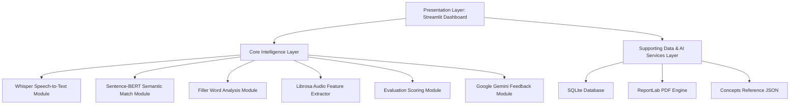

# Voice-Based Concept Understanding Analyser (VBCUA)

Voice-Based Concept Understanding Analyser (VBCUA) is a complete, production-ready AI web application designed to evaluate oral technical concepts explained by students. Using machine learning (OpenAI Whisper & Sentence-BERT), digital signal processing (Librosa), and Generative AI (Google Gemini API), VBCUA calculates multi-dimensional grades (Semantic Knowledge Match, Speech Fluency, and Acoustic Confidence) and generates structured academic feedback reports.

---

## 🏗️ System Architecture

The system consists of three main architectural layers:



1. **Presentation Layer (Streamlit)**:
   - Modern, responsive student dashboard including metric-cards, multi-tab result details, interactive histograms, raw audio playback, and visual waveforms.
   - Comprehensive history log to view, search, inspect, or purge saved evaluation summaries.
   - Interactive conceptual database manager to read or append new academic definition reference targets.

2. **Core Intelligence Layer**:
   - **Speech-to-Text (`models/whisper_model.py`)**: Local OpenAI Whisper Base model transcribes audio inputs (MP3/WAV) to text.
   - **Semantic Understanding (`models/semantic_model.py`)**: Hugging Face Sentence-BERT (`all-MiniLM-L6-v2`) calculates cosine similarities against standardized descriptions.
   - **Filler Word Detection (`models/filler_analysis.py`)**: Scans for verbal fillers (*um, uh, like, actually, basically, you know, kind of, sort of*) and counts frequency and percentages.
   - **Audio Feature Extraction (`models/audio_features.py`)**: DSP calculations with Librosa mapping duration, speaking time, silent time, pause ratio, RMS volume energy, zero-crossing rate, estimated speaking rate (WPM), and F0 vocal pitch.
   - **Scoring Engine (`models/scoring.py`)**: Composites scores into final ratings (70% Semantic Match, 20% Fluency, 10% Confidence), letter grades (A/B/C/D/F), and performance categories.
   - **AI Feedback Engine (`models/gemini_feedback.py`)**: Google Gemini API (`gemini-1.5-flash`) writes detailed, encouraging educational reviews mapping strengths, weaknesses, missing sub-concepts, and communication tips. Standard fallback engine is integrated if offline or API key is absent.

3. **Supporting Data & AI Services Layer**:
   - **SQLite Database (`database/database.py`)**: Stores profile evaluations, scores, transcripts, and reviews.
   - **PDF Engine (`reports/pdf_report.py`)**: Auto-compiles student assessments, numerical score banners, audio waveforms, transcriptions, and feedback cards into report templates via ReportLab.
   - **Reference Concepts (`reference_concepts/concepts.json`)**: Pre-configured dictionary of academic definitions.

---

## 🛠️ Folder Structure

```
VBCUA/
│
├── app.py                      # Main Streamlit presentation dashboard
├── requirements.txt            # Project dependencies list
├── README.md                   # System documentation
├── .env.example                # Template configuration for Gemini API keys
├── .gitignore                  # Git tracking exclusion list
│
├── reference_concepts/
│   └── concepts.json           # Academic reference definitions repository
│
├── models/
│   ├── whisper_model.py        # Speech-to-Text transcription module
│   ├── semantic_model.py       # Sentence-BERT similarity computation module
│   ├── filler_analysis.py      # Linguistic filler word analyzer
│   ├── audio_features.py       # Librosa audio features processor
│   ├── scoring.py              # Grade and composite scoring engine
│   └── gemini_feedback.py      # Google Gemini feedback generator (with offline fallback)
│
├── reports/
│   └── pdf_report.py           # ReportLab assessment report compiler
│
├── database/
│   └── database.py             # SQLite data operations controller
│
├── audio/
│   └── uploads/                # Temporary workspace for uploaded audio files
│
├── output/                     # Export directory for assessment PDF reports
│
└── utils/
    └── helper.py               # Waveform plotting & file manipulation helpers
```

---

## 🚀 Installation & Requirements

### Prerequisites
- **Python 3.9 - 3.11** (recommended version)
- **FFmpeg**: Required by Librosa and Whisper to decode audio files.
  - *Windows*: Download via [Gyan.dev](https://www.gyan.dev/ffmpeg/builds/) and add its `/bin` directory to your system path.
  - *macOS*: Run `brew install ffmpeg`
  - *Linux*: Run `sudo apt install ffmpeg`

### Installation Steps

1. **Clone the project workspace directory.**
2. **Set up a virtual environment (optional but recommended):**
   ```bash
   python -m venv venv
   source venv/bin/activate  # On Windows: venv\Scripts\activate
   ```
3. **Install the dependencies:**
   ```bash
   pip install -r requirements.txt
   ```
   *Note: PyTorch and SentenceTransformers will download model weights on their first execution. This might take a few moments depending on connection speed.*

4. **Configure Environment Variables:**
   - Copy `.env.example` to `.env`
   - Paste your Gemini API key:
     ```env
     GEMINI_API_KEY=AIzaSy...
     ```

---

## 🖥️ How to Run

Launch the Streamlit web server using:
```bash
streamlit run app.py
```
The application dashboard will automatically open in your default browser at `http://localhost:8501`.

---

## 🔄 Assessment Pipeline Workflow

```
1. File Upload (WAV/MP3) & Profile Setup
   ↓
2. Local Whisper Audio Transcription
   ↓
3. Librosa Feature Extraction (RMS Energy, Duration, Silence, Pitch)
   ↓
4. Filler Word Frequency Scanning
   ↓
5. Sentence-BERT Similarity Embedding (Cosine Alignment)
   ↓
6. Composite Scoring Calculation & Category Classification
   ↓
7. Gemini Feedback / Rule-based Fallback Generation
   ↓
8. Matplotlib Waveform Signal Generation
   ↓
9. SQLite Log Storage & ReportLab PDF Report Compilation
   ↓
10. Dashboard Rendering & PDF Download Delivery
```

---

## 🔮 Future Scope
- **Real-time Recording**: Integrate a direct-recording component in the Streamlit UI using standard HTML5 microphone interfaces.
- **Multilingual Support**: Extend Whisper models and reference databases to support non-English scientific concept definitions.
- **Pronunciation Scoring**: Integrate phone-level alignment (e.g., using Wav2Vec2) to evaluate accents and phonetic accuracy.
- **Multi-student Cohort Analysis**: Generate class-wide progress analytics and group performance reporting dashboards.
